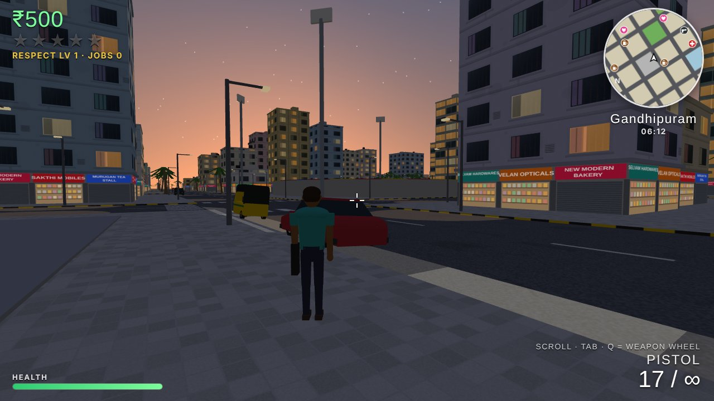
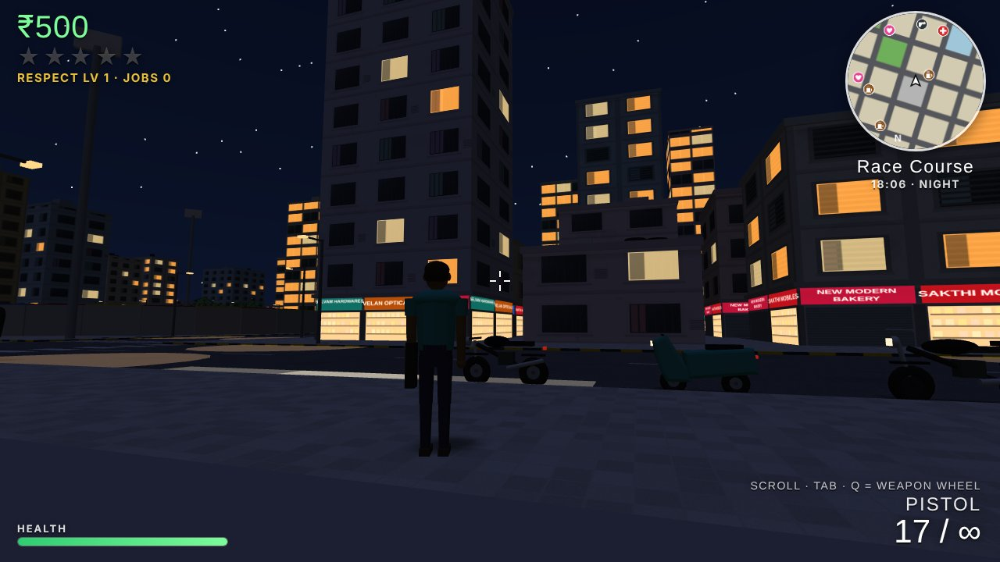
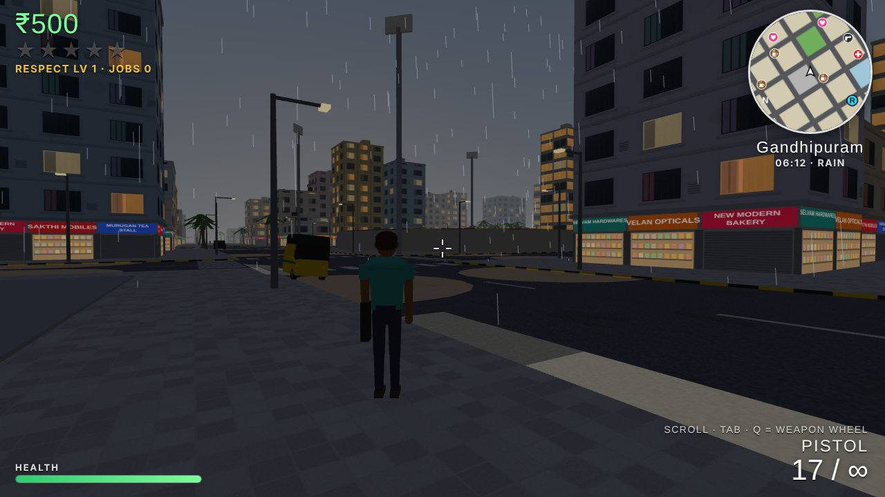
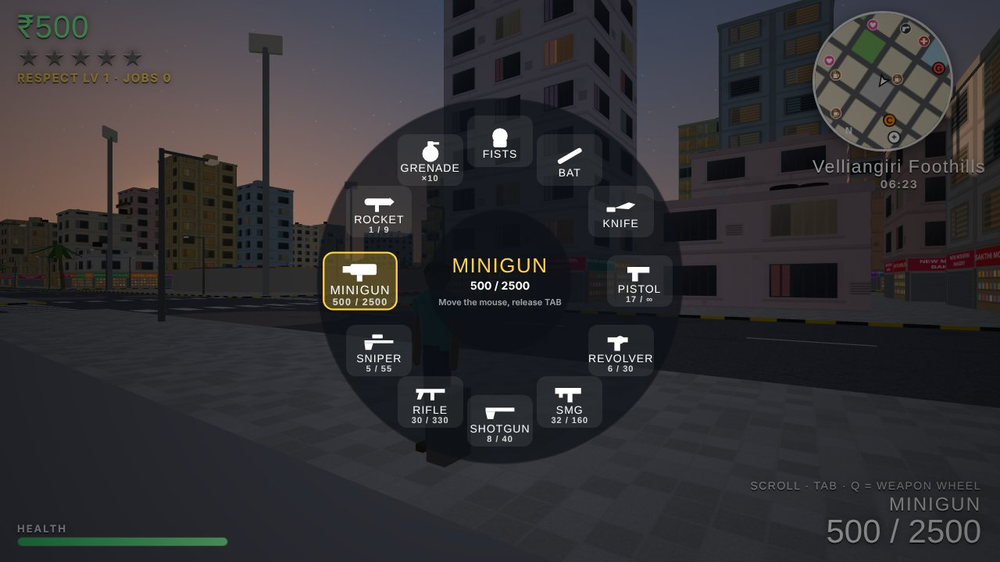
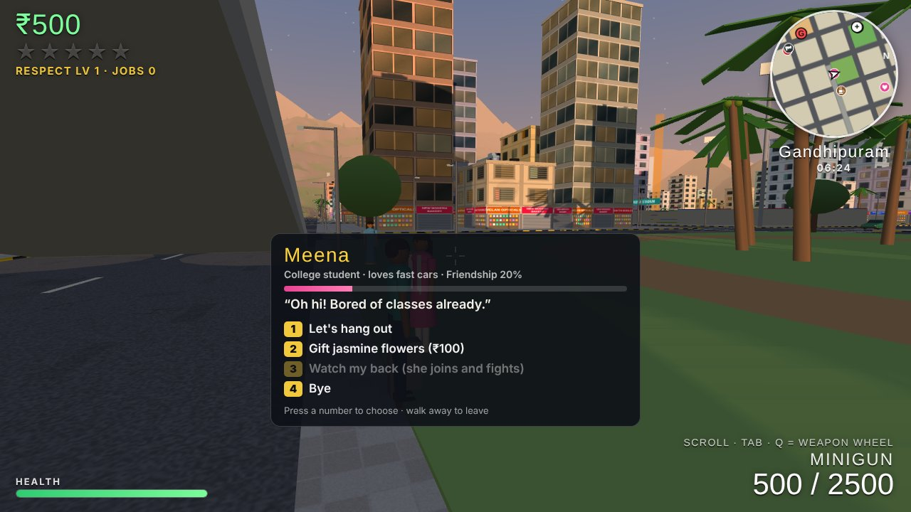
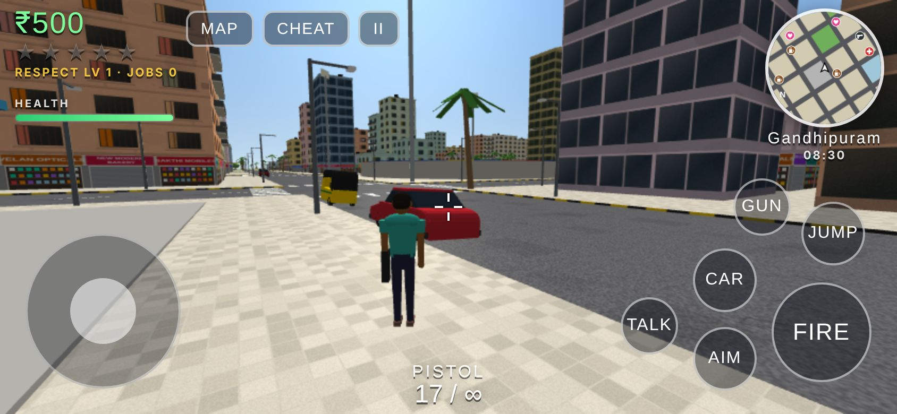

# 🛺 Kovai Streets

**A 3D open-world sandbox game set in a city inspired by Coimbatore (Kovai), Tamil Nadu. It runs in any web browser, on a computer or a phone.**

Drive autos down Avinashi Road, take the ghat road up into the Western Ghats, swim off the coast, grab a tea at a street-corner kadai and take on the gangs of Ukkadam.


> **Built with AI.** Every line of code, every texture, character and vehicle in this game was generated by [Claude](https://claude.ai) (Anthropic's AI) through plain-language conversation. There are no external 3D models, image files or game engine. The game is one HTML file plus the Three.js library. It's an early experiment in what AI-assisted game making can do.

---

## 📑 Contents

- [Screenshots](#-screenshots)
- [Features](#-features)
- [Controls](#-controls)
- [Cheat codes](#-cheat-codes)
- [The map](#-the-map)
- [Vehicles](#-vehicles)
- [Weapons](#-weapons)
- [Jobs and missions](#-jobs-and-missions)
- [Friends and people](#-friends-and-people)
- [Graphics settings](#-graphics-settings)
- [Run it locally](#-run-it-locally)
- [Host it for free](#-host-it-for-free)
- [How it's built](#-how-its-built)
- [Known limitations](#-known-limitations)
- [Roadmap ideas](#-roadmap-ideas)
- [Credits and licence](#-credits-and-licence)

---

## 📸 Screenshots

### The city

| | |
|---|---|
|  |  |
| **Gandhipuram in the morning.** Shopfronts, painted kerbs, autos and traffic. | **The Avinashi Road flyover at dusk**, with the Ghats behind. |
|  |  |
| **Night.** Lit windows, glowing shop signs, street lights and stars. | **Monsoon rain.** Grey skies, wet roads, umbrellas. |

### The Western Ghats

| | |
|---|---|
|  |  |
| **The ghat road.** Hairpin bends cut into the mountainside. | **Hilltop viewpoint at dawn**, at the top of the climb. |
|  | |
| **The hill statue** in the Velliangiri foothills. | |

### The coast

| | |
|---|---|
|  |  |
| **Kovai Coast.** Umbrellas, fishing boats and rolling surf. | **Speedboat** on the open sea. Boats bob with the waves. |
|  |  |
| **The lighthouse** on its headland. Its beam sweeps at night. | **Swimming.** Wade in the shallows, swim in the deep. |

### Places to explore

| | |
|---|---|
|  |  |
| **Kovai Market.** A crowd among the produce stalls. | **Kovai Central mall.** Three floors you can walk through. |
|  |  |
| **Kovai Junction.** The train stops at the platform. | **Kovai Stadium**, with joggers on the track. |

### Gameplay

| | |
|---|---|
|  |  |
| **18 drivable vehicles**, from bicycles to buses. | **The weapon wheel.** 12 weapons, time slows while it's open. |
|  |  |
| **Friends.** Hang out with Meena and Divya. | **Hand-to-hand combat**, with punch and kick combos. |

### On a phone



*Plays on phones in landscape, with a virtual joystick, swipe-to-look and on-screen buttons.*

---

## ✨ Features

### 🏙️ A living city
- **10 × 10 city blocks** with procedurally generated buildings in four styles: painted residential, brick, glass office and old commercial.
- **Shopfronts on every street**: Sri Lakshmi Stores, Kovai Textiles, Raj Medicals, Hotel Arul and more, with shelves of goods and roll-down shutters.
- Balconies, rooftop water tanks, AC units and satellite dishes.
- Textured asphalt, paved sidewalks, **black-and-yellow kerbs** and zebra crossings.
- **Traffic keeps to the left**, Indian-style. Two-wheelers weave between cars, and cars honk when blocked.

### 🌅 Day, night and weather
- A full **day–night cycle** (one game day ≈ 16 real minutes), with the sun setting behind the Western Ghats.
- At night: **lit windows, glowing shop signs, street lights, headlights**, stars and the moon.
- **Monsoon rain** comes and goes on its own: wet shiny roads, umbrellas, thunder and lightning, and slipperier driving.

### ⛰️ Mountains and 🌊 the sea
- **Western Ghats terrain** you can drive or walk up, with tea-estate slopes, forest, a hill village, a roadside waterfall and a summit viewpoint.
- A **made-up coastline** (Coimbatore has none in real life!) with a beach, shacks, a lifeguard tower, a lighthouse and a jetty.
- **Animated waves** with foam at the shoreline. Boats bob and tilt with the swell.
- **Water physics:** wade in the shallows, swim in deep water, and watch cars float for a moment before they sink.

### 🎮 Gameplay
- Third-person on foot, driving, riding and boating.
- **Mass-based crash physics**: cars spin and shove, buses barely move, tanks flatten everything.
- Damaged vehicles smoke, catch fire and explode.
- **Wanted level** up to 5 stars, with police chases and sirens.
- **7 job types**, plus respect levels that raise your rewards.
- **Talk to anyone** on the street, and make friends with Meena and Divya.
- **Tea stalls** restore health, the **hospital** heals you for free, and the **gun shop** sells weapons and armour.

---

## 🕹️ Controls

### Keyboard and mouse

| Key | Action |
|---|---|
| `W` `A` `S` `D` | Move / drive |
| Mouse | Look around (click the game to lock the mouse) |
| Left click | Shoot / punch combo (hold for automatic weapons) |
| Right click | Aim / sniper scope |
| `Shift` | Sprint |
| `Space` | Jump / handbrake |
| `E` or `F` | Get in / out of a vehicle |
| `T` | Talk to people, friends and tea stalls |
| Mouse wheel, `Tab` (hold) or `Q` | Weapon wheel |
| `1`–`9`, `0`, `-`, `=` | Pick a weapon directly |
| `R` | Reload |
| `H` | Horn |
| `M` | Full city map |
| `Enter` or `` ` `` | Type a cheat code |
| `Esc` or `P` | Pause (includes the cheat list and graphics settings) |
| Arrow keys | Look around without a mouse |

### Phone and tablet (landscape)

| Control | Action |
|---|---|
| Left joystick | Walk / drive (push all the way to run) |
| Swipe on the right side | Look and aim |
| **FIRE** | Shoot / punch (hold for automatic weapons, includes light aim assist) |
| **AIM** | Toggle aim / sniper scope |
| **CAR / EXIT** | Get in / out |
| **JUMP / BRAKE** | Jump on foot, handbrake when driving |
| **GUN** | Open the weapon wheel |
| **TALK / HORN** | Talk on foot, horn when driving |
| **MAP · CHEAT · II** | Map, cheat box, pause |

---

## 🔑 Cheat codes

Press **Enter** while playing, type a code and press **Enter** again. You can also tap any code on the pause screen.

| Code | Effect |
|---|---|
| `NUTTERTOOLS` | Minigun, rocket launcher, grenades, sniper rifle, assault rifle and knife |
| `PROFESSIONALTOOLS` | SMG, shotgun, assault rifle, sniper rifle, revolver and cricket bat |
| `LEAVEMEALONE` | Clear your wanted level |
| `COOLDOWN` | Same as above. The cops chill out |
| `BIGBANG` | Blow up every vehicle nearby |
| `PANZER` | Spawn a tank (left click fires the cannon) |
| `FILTERCOFFEE` | Full health and armour |
| `KOVAICASH` | +₹50,000 |
| `AUTORAJA` | Spawn a turbo auto |
| `IRONBODY` | Your vehicle can't be damaged (toggle) |
| `SUNRISE` | Jump to morning |
| `SUNDOWN` | Jump to sunset |
| `MIDNIGHT` | Jump to night |
| `MONSOON` | Rain on / off |

---

## 🗺️ The map

The map is loosely based on Coimbatore's real layout, with some creative licence.

| Area | What's there |
|---|---|
| **Gandhipuram** | Where you start. The bus stand and busy shopping streets |
| **Town Hall** | Clock tower, Kovai Market, gun shop |
| **R.S. Puram** | Kovai Central mall and the park |
| **Race Course** | Walking track. Meena's hangout |
| **Peelamedu** | The Avinashi Road flyover, textile mills, the IT park (Divya), the college campus |
| **Ukkadam** | Lake (swim or take the rowboat) and a gang hangout |
| **Singanallur** | Lake and mills |
| **Podanur** | Kovai Junction railway station and the train line |
| **Velliangiri Foothills** | The hill statue |
| **Marudhamalai Foothills** | Temple with a walk-in shrine |
| **Ghat Road / Hilltop Viewpoint** | Hairpin climb into the Western Ghats, waterfall, hill village |
| **Kovai Coast / Lighthouse Point** | Beach, jetty, boats, lighthouse |

**Map icons:** ✚ hospital (stand on the red ring to heal) · 🔫 gun shop · ♥ friends · ☕ tea stalls · coloured letters = jobs

---

## 🚗 Vehicles

**Cars and vans:** sedan, hatchback, SUV, jeep, van, taxi, police car, *Kovai Racer* sports car (a friendship reward)

**Commercial:** auto-rickshaw, turbo auto (cheat), town bus with route boards, lorry, mini truck, ambulance

**Two-wheelers:** commuter bike, cruiser bike, sports bike, scooter, retro scooter, moped, bicycle

**Boats:** speedboat, fishing boat, rowboat

**Special:** tank (`PANZER` cheat)

Every vehicle has its own weight, speed, grip and handling. Bikes lean into turns and can throw you off in a hard crash, cyclists pedal, and boats ride the waves.

---

## 🔫 Weapons

| # | Weapon | Notes |
|---|---|---|
| 1 | Fists | Jab, jab, kick combo |
| 2 | Cricket bat | Heavy swings, dents cars |
| 3 | Knife | Fast melee |
| 4 | Pistol | Starting weapon, unlimited ammo |
| 5 | Revolver | Slow and powerful |
| 6 | SMG | Fast automatic fire |
| 7 | Shotgun | Fires 9 pellets |
| 8 | Assault rifle | All-rounder |
| 9 | Sniper rifle | Zoom scope |
| 0 | Minigun | Cheat only |
| - | Rocket launcher | Explosive |
| = | Grenades | Bounce, then explode after a couple of seconds |

Get weapons from the **Kovai Arms Depot** gun shop, as drops from gang members, or with cheats.

---

## 💼 Jobs and missions

Three jobs show on the map at a time, each with its own coloured beam and letter:

| Letter | Job | Goal |
|---|---|---|
| **D** | Delivery | Rush goods (wet-grinder parts, jasmine garlands, biryani…) across town |
| **R** | Street race | Hit 7 checkpoints before time runs out |
| **G** | Gang clean-up | Take out a gang squeezing shopkeepers |
| **B** | Gang boss | Bring down a named boss and his guards |
| **C** | Getaway chase | Wreck a fleeing car before it escapes |
| **F** | Passenger fare | Drive a passenger to their stop |
| **+** | Emergency run | Rush an injured person to the Government Hospital |

Each job you finish raises your **Respect level**, and rewards grow with it.

---

## 💬 Friends and people

- **Anyone on the street:** say vanakkam, buy them a filter coffee, ask what's going on nearby, or offer a paid lift. Some people fight back if you hit them.
- **Meena** (college student, loves fast cars) and **Divya** (software engineer at the IT park): hang out at places around the city, gift jasmine flowers, and once they trust you, they'll join you and help in fights.
  - At 100% friendship, Meena gives you her sports car and Divya gives you free armour whenever you visit.
- **Tea stalls:** tea (₹10), medu vadai (₹15) and bun butter jam (₹30) restore your health.

---

## ⚙️ Graphics settings

Pick **Low / Medium / High** on the start screen or the pause screen. Changing it reloads the game.

| Setting | Shadows | Resolution | People | Traffic | Trees |
|---|---|---|---|---|---|
| Low (default on phones) | Off | 1× | ~40 | 30 | Fewer |
| Medium (default on computers) | On | up to 1.25× | ~70 | 42 | Normal |
| High | Sharp | up to 1.75× | ~95 | 52 | Dense |

You can also open the game straight into a setting by adding `#low`, `#medium` or `#high` to the end of the link.

---

## 💻 Run it locally

No install or build step is needed.

```text
kovai-streets/
├── index.html          ← the whole game
├── three.min.js        ← Three.js r128 (3D engine)
├── THREE-LICENSE.txt   ← Three.js MIT licence
├── README.md
└── screenshots/
```

1. Download or clone the folder.
2. Double-click `index.html` to open it in Chrome, Edge, Firefox or Safari.

If your browser blocks local files, run a tiny local server from the folder:

```bash
# Python 3
python -m http.server 8000
# then open http://localhost:8000
```

---

## 🌐 Host it for free

### Netlify (easiest, about 5 minutes)
1. Go to [app.netlify.com/drop](https://app.netlify.com/drop).
2. Drag the `kovai-streets` folder onto the page. It goes live in seconds.
3. **Sign up for a free account straight away to claim the site.** Unclaimed drops are deleted after a short time.
4. Rename it under *Site settings* to get a link like `kovai-streets.netlify.app`.
5. To update, drag the new folder onto your site's **Deploys** page.

### GitHub Pages
1. Create a public repository and upload all the files, including `screenshots/`.
2. Go to *Settings → Pages* and set the source to `main` / root.
3. Your game will be at `https://<your-username>.github.io/<repo-name>/`.

### itch.io (best for reaching gamers)
1. Create a new project and set **Kind of project** to **HTML**.
2. Upload a ZIP of `index.html`, `three.min.js` and `THREE-LICENSE.txt`.
3. Tick **"This file will be played in the browser"**.
4. Mark the content as containing violence, since there are guns, fights and police chases.

---

## 🛠️ How it's built

| | |
|---|---|
| **Engine** | [Three.js](https://threejs.org) r128 (WebGL) |
| **Code** | One self-contained `index.html` (~240 KB of hand-generated JavaScript) |
| **Art** | 100% procedural. Every texture is drawn with Canvas 2D at load time; every model is built from code |
| **Sound** | Generated live with the Web Audio API (engines, sirens, gunshots, rain, train horn) |
| **Load time** | About 1–2 seconds to build the whole world |

Some of the techniques used:
- **Geometry batching:** thousands of static buildings and props are merged into a handful of meshes for performance.
- **Procedural facade textures** with lit and unlit window maps that glow at night.
- **Extruded side profiles** for curved car bodies. People are merged into about 7 meshes each, with jointed limbs.
- **Heightmap terrain** with a Catmull-Rom ghat road carved into it.
- **A custom GLSL water shader** with wave displacement, foam, a Fresnel sky reflection and fog. The same wave formula runs in JavaScript so boats and swimmers stay in sync.
- **A spatial-hash collision grid** with height-aware colliders, so you can drive under the flyover and walk under mall floors.
- **Vehicle physics** with mass, lateral grip, impulse collisions, spin, slopes and buoyancy.
- **Traffic AI** that follows the road grid, keeps left and yields to the vehicle ahead.

---

## ⚠️ Known limitations

- **Visual style:** it's stylised and low-poly. Everything is generated by code without hand-made 3D models, so characters and vehicles are simple up close.
- **Traffic:** AI traffic stays inside the city grid. The ghat road and coast road have no AI cars.
- **No save system:** cash, weapons and progress reset when you close the page.
- **Performance:** older phones should use **Low** quality. High quality is meant for desktop GPUs.
- **Geography:** Coimbatore has no coastline in real life. The beach is a fun addition.

---

## 🧭 Roadmap ideas

- [ ] Save and load progress
- [ ] AI traffic on the ghat and coast roads
- [ ] A short storyline with connected missions
- [ ] Police on foot, roadblocks and helicopters at high wanted levels
- [ ] Car radio with original music
- [ ] Buyable houses and garages
- [ ] Gamepad support
- [ ] Online multiplayer

---

## 📜 Credits and licence

- **Game design and direction:** *[Your name here]*
- **Code, models and textures:** generated with **Claude** by Anthropic, through conversation
- **3D engine:** [Three.js](https://threejs.org) © three.js authors, MIT licence (see `THREE-LICENSE.txt`)
- **Fonts:** [Bebas Neue](https://fonts.google.com/specimen/Bebas+Neue) and [Rajdhani](https://fonts.google.com/specimen/Rajdhani) via Google Fonts (SIL Open Font Licence)

**About the content:** real neighbourhood and road names are used only to evoke Coimbatore's geography. All shops, brands, characters, the mall, the station design and the statue are original and fictional. Kovai Streets is an independent fan project inspired by open-world games. It is not affiliated with, or endorsed by, any game publisher.

---

<p align="center">Made with ❤️ for Kovai · <i>Vanakkam!</i> 🙏</p>
