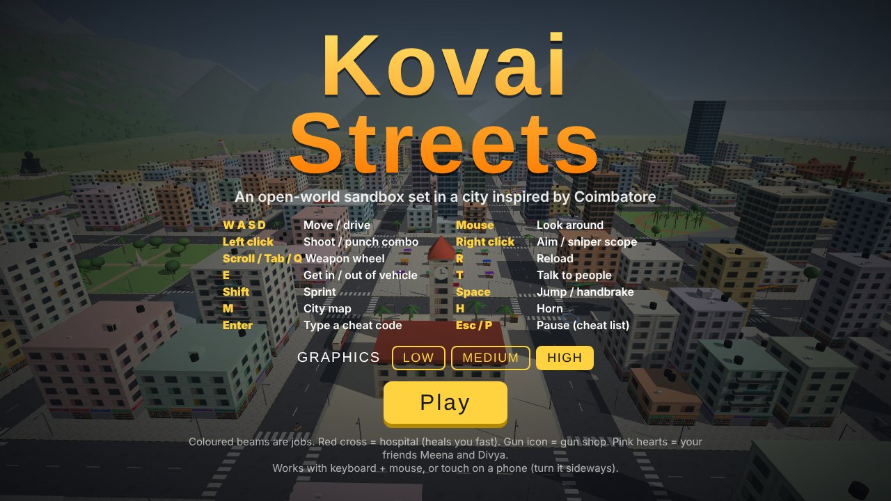
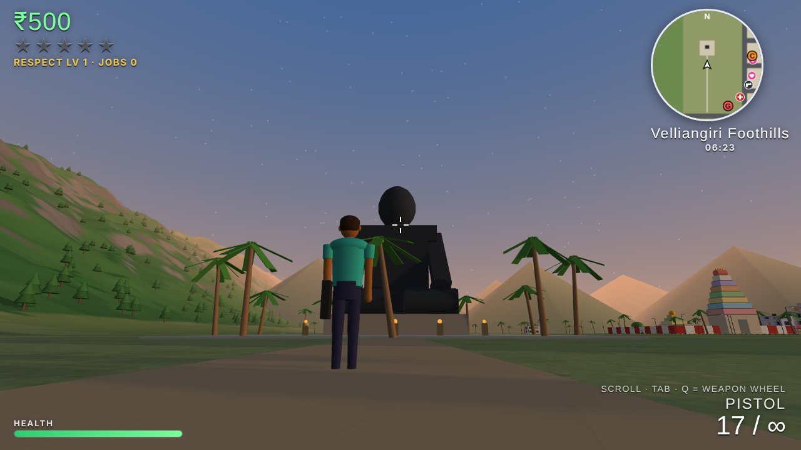
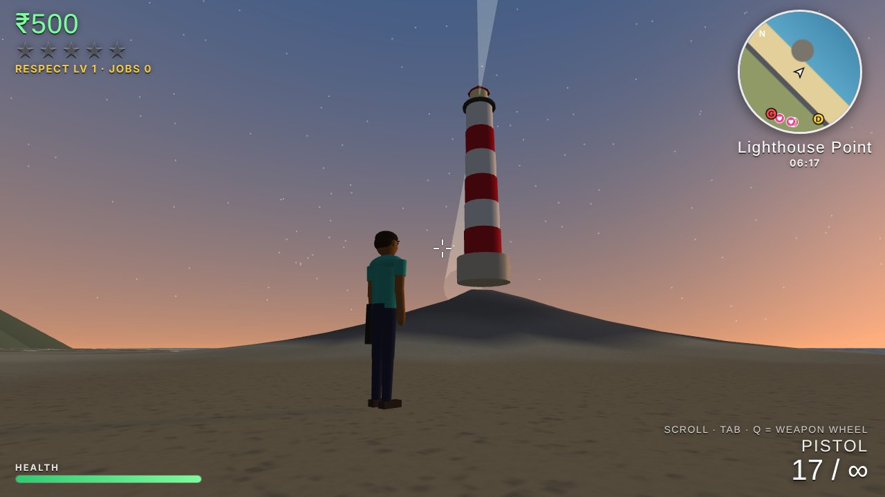
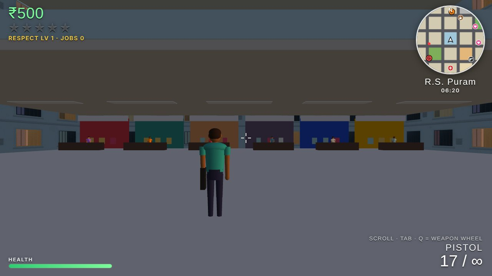
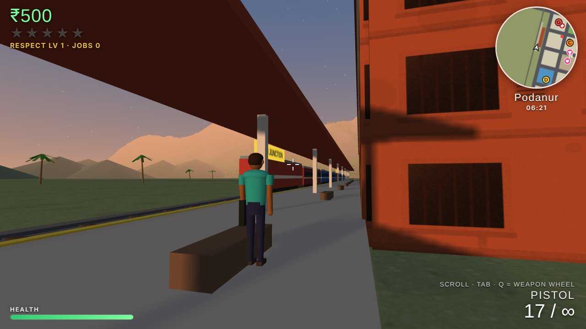
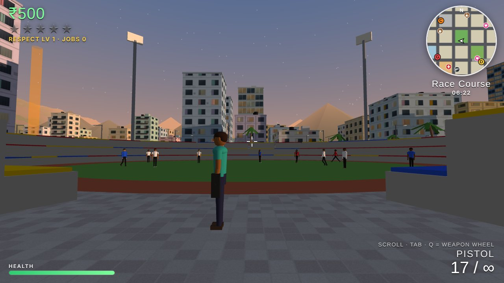
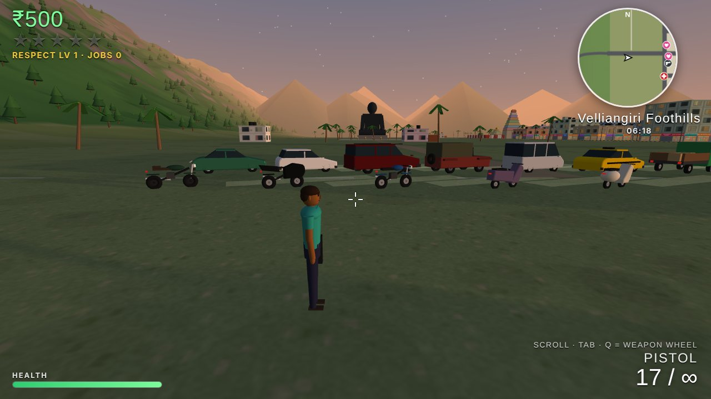

# 🛺 Kovai Streets

**A 3D open-world sandbox game set in a city inspired by Coimbatore (Kovai), Tamil Nadu. It runs in any web browser, on a computer or a phone.**

Drive autos down Avinashi Road, take the ghat road up into the Western Ghats, swim off the coast, grab a tea at a street-corner kadai and take on the gangs of Ukkadam.



> **Built with AI.** Every line of code, every texture, character and vehicle in this game was generated by [Claude](https://claude.ai) (Anthropic's AI) through plain-language conversation. There are no external 3D models, image files or game engine. The game is one HTML file plus the Three.js library. It's an early experiment in what AI-assisted game making can do.

---

## 📑 Contents

- [Screenshots](#-screenshots)
- [Features](#-features)
- [Controls](#-controls)
- [Cheat codes](#-cheat-codes)
- [The map](#-the-map)
- [Vehicles](#-vehicles)
- [Weapons](#-weapons)
- [Jobs and missions](#-jobs-and-missions)
- [Story: the Black Scorpions](#-story-the-black-scorpions)
- [Progress, unlocks and saving](#-progress-unlocks-and-saving)
- [Things to find](#-things-to-find)
- [Police](#-police)
- [Friends and people](#-friends-and-people)
- [Graphics settings](#-graphics-settings)
- [Run it locally](#-run-it-locally)
- [Host it for free](#-host-it-for-free)
- [How it's built](#-how-its-built)
- [Known limitations](#-known-limitations)
- [Roadmap ideas](#-roadmap-ideas)
- [Credits and licence](#-credits-and-licence)

---

## 📸 Screenshots

### The city

| | |
|---|---|
|  |  |
| **Gandhipuram in the morning.** Shopfronts, painted kerbs, autos and traffic. | **The Avinashi Road flyover at dusk**, with the Ghats behind. |
|  |  |
| **Night.** Lit windows, glowing shop signs, street lights and stars. | **Monsoon rain.** Grey skies, wet roads, umbrellas. |

### The Western Ghats

| | |
|---|---|
|  |  |
| **The ghat road.** Hairpin bends cut into the mountainside. | **Hilltop viewpoint at dawn**, at the top of the climb. |
|  | |
| **The hill statue** in the Velliangiri foothills. | |

### The coast

| | |
|---|---|
|  |  |
| **Kovai Coast.** Umbrellas, fishing boats and rolling surf. | **Speedboat** on the open sea. Boats bob with the waves. |
|  |  |
| **The lighthouse** on its headland. Its beam sweeps at night. | **Swimming.** Wade in the shallows, swim in the deep. |

### Places to explore

| | |
|---|---|
|  |  |
| **Kovai Market.** A crowd among the produce stalls. | **Kovai Central mall.** Three floors you can walk through. |
|  |  |
| **Kovai Junction.** The train stops at the platform. | **Kovai Stadium**, with joggers on the track. |

### Gameplay

| | |
|---|---|
|  |  |
| **18 drivable vehicles**, from bicycles to buses. | **The weapon wheel.** 12 weapons, time slows while it's open. |
|  |  |
| **Friends.** Hang out with Meena and Divya. | **Hand-to-hand combat**, with punch and kick combos. |

### On a phone


*Plays on phones in landscape, with a virtual joystick, swipe-to-look and on-screen buttons.*

---

## ✨ Features

### 🏙️ A living city
- **10 × 10 city blocks** with procedurally generated buildings in four styles: painted residential, brick, glass office and old commercial.
- **Shopfronts on every street**: Sri Lakshmi Stores, Kovai Textiles, Raj Medicals, Hotel Arul and more, with shelves of goods and roll-down shutters.
- Balconies, rooftop water tanks, AC units and satellite dishes.
- Textured asphalt, paved sidewalks, **black-and-yellow kerbs** and zebra crossings.
- **Traffic keeps to the left**, Indian-style. Two-wheelers weave between cars, and cars honk when blocked.

### 🌅 Day, night and weather
- A full **day–night cycle** (one game day ≈ 16 real minutes), with the sun setting behind the Western Ghats.
- At night: **lit windows, glowing shop signs, street lights, headlights**, stars and the moon.
- **Monsoon rain** comes and goes on its own: wet shiny roads, umbrellas, thunder and lightning, and slipperier driving.

### ⛰️ Mountains and 🌊 the sea
- **Western Ghats terrain** you can drive or walk up, with tea-estate slopes, forest, a hill village, a roadside waterfall and a summit viewpoint.
- A **made-up coastline** (Coimbatore has none in real life!) with a beach, shacks, a lifeguard tower, a lighthouse and a jetty.
- **Animated waves** with foam at the shoreline. Boats bob and tilt with the swell.
- **Water physics:** wade in the shallows, swim in deep water, and watch cars float for a moment before they sink.

### 🎮 Gameplay
- Third-person on foot, driving, riding and boating.
- **Mass-based crash physics**: cars spin and shove, buses barely move, tanks flatten everything.
- Damaged vehicles smoke, catch fire and explode.
- **Wanted level** up to 5 stars: police cars, **officers on foot, roadblocks and a helicopter**.
- **A 6-mission story** with original characters, ending in a boss fight.
- **7 job types**, plus Respect levels that unlock guns, jobs and whole new areas.
- **Your progress saves automatically** on your device.
- **A safehouse with a garage** that keeps your cars, plus outfits to change into.
- **20 hidden film reels, 5 stunt jumps and 4 rampages** to find.
- **Lock-on aiming, crouching behind cover, vaulting over low walls**, and knockdowns.
- **Visible car damage:** dents, smashed windows and flat tyres.
- **Car radio** with three original stations, plus engine sounds that differ by vehicle, gun sounds, footsteps and city ambience.
- **Talk to anyone** on the street, and make friends with Meena and Divya.
- **Tea stalls** restore health, the **hospital** heals you for free, and the **gun shop** sells weapons and armour.

---

## 🕹️ Controls

### Keyboard and mouse

| Key | Action |
|---|---|
| `W` `A` `S` `D` | Move / drive |
| Mouse | Look around (click the game to lock the mouse) |
| Left click | Shoot / punch combo (hold for automatic weapons) |
| Right click (hold) | Aim and **lock on** to the nearest enemy / sniper scope |
| `Shift` | Sprint |
| `Space` | Jump (vault onto low walls) / handbrake |
| `E` or `F` | Get in / out of a vehicle |
| `T` | Talk to people, friends and tea stalls |
| Mouse wheel, `Tab` (hold) or `Q` | Weapon wheel |
| `1`–`9`, `0`, `-`, `=` | Pick a weapon directly |
| `R` | Reload |
| `C` | Crouch (next to a wall or car = in cover) |
| `N` | Change radio station (in a vehicle) |
| `H` | Horn |
| `M` | Full city map |
| `Enter` or `` ` `` | Type a cheat code |
| `Esc` or `P` | Pause: progress, cheat list and settings |
| Arrow keys | Look around without a mouse |

### Phone and tablet (landscape)

| Control | Action |
|---|---|
| Left joystick | Walk / drive (push all the way to run) |
| Swipe on the right side | Look and aim |
| **FIRE** | Shoot / punch (hold for automatic weapons, includes light aim assist) |
| **AIM** | Toggle aim / sniper scope |
| **CAR / EXIT** | Get in / out |
| **JUMP / BRAKE** | Jump on foot, handbrake when driving |
| **GUN** | Open the weapon wheel |
| **TALK / HORN** | Talk on foot, horn when driving |
| **MAP · RADIO · CROUCH · CHEAT · II** | Map, radio, take cover, cheat box, pause |

---

## 🔑 Cheat codes

Press **Enter** while playing, type a code and press **Enter** again. You can also tap any code on the pause screen.

| Code | Effect |
|---|---|
| `NUTTERTOOLS` | Minigun, rocket launcher, grenades, sniper rifle, assault rifle and knife |
| `PROFESSIONALTOOLS` | SMG, shotgun, assault rifle, sniper rifle, revolver and cricket bat |
| `LEAVEMEALONE` | Clear your wanted level |
| `COOLDOWN` | Same as above. The cops chill out |
| `BIGBANG` | Blow up every vehicle nearby |
| `PANZER` | Spawn a tank (left click fires the cannon) |
| `FILTERCOFFEE` | Full health and armour |
| `KOVAICASH` | +₹50,000 |
| `AUTORAJA` | Spawn a turbo auto |
| `IRONBODY` | Your vehicle can't be damaged (toggle) |
| `SUNRISE` | Jump to morning |
| `SUNDOWN` | Jump to sunset |
| `MIDNIGHT` | Jump to night |
| `MONSOON` | Rain on / off |

---

## 🗺️ The map

The map is loosely based on Coimbatore's real layout, with some creative licence.

| Area | What's there |
|---|---|
| **Gandhipuram** | Where you start. The bus stand and busy shopping streets |
| **Town Hall** | Clock tower, Kovai Market, gun shop |
| **R.S. Puram** | Kovai Central mall and the park |
| **Race Course** | Walking track. Meena's hangout |
| **Peelamedu** | The Avinashi Road flyover, textile mills, the IT park (Divya), the college campus |
| **Ukkadam** | Lake (swim or take the rowboat) and a gang hangout |
| **Singanallur** | Lake and mills |
| **Podanur** | Kovai Junction railway station and the train line |
| **Velliangiri Foothills** | The hill statue |
| **Marudhamalai Foothills** | Temple with a walk-in shrine |
| **Ghat Road / Hilltop Viewpoint** | Hairpin climb into the Western Ghats, waterfall, hill village |
| **Kovai Coast / Lighthouse Point** | Beach, jetty, boats, lighthouse |

**Map icons:** ✚ hospital (stand on the red ring to heal) · 🔫 gun shop · ♥ friends · ☕ tea stalls · coloured letters = jobs · gold **S** = story · green house = safehouse · skull = rampage

The **Western Ghats** and **Kovai Coast** start closed. See [Progress, unlocks and saving](#-progress-unlocks-and-saving).

---

## 🚗 Vehicles

**Cars and vans:** sedan, hatchback, SUV, jeep, van, taxi, police car, *Kovai Racer* sports car (a friendship reward)

**Commercial:** auto-rickshaw, turbo auto (cheat), town bus with route boards, lorry, mini truck, ambulance

**Two-wheelers:** commuter bike, cruiser bike, sports bike, scooter, retro scooter, moped, bicycle

**Boats:** speedboat, fishing boat, rowboat

**Special:** tank (`PANZER` cheat)

Every vehicle has its own weight, speed, grip and handling. Bikes lean into turns and can throw you off in a hard crash, cyclists pedal, and boats ride the waves.

---

## 🔫 Weapons

| # | Weapon | Notes |
|---|---|---|
| 1 | Fists | Jab, jab, kick combo |
| 2 | Cricket bat | Heavy swings, dents cars |
| 3 | Knife | Fast melee |
| 4 | Pistol | Starting weapon, unlimited ammo |
| 5 | Revolver | Slow and powerful |
| 6 | SMG | Fast automatic fire |
| 7 | Shotgun | Fires 9 pellets |
| 8 | Assault rifle | All-rounder |
| 9 | Sniper rifle | Zoom scope |
| 0 | Minigun | Cheat only |
| - | Rocket launcher | Explosive |
| = | Grenades | Bounce, then explode after a couple of seconds |

Get weapons from the **Kovai Arms Depot** gun shop, as drops from gang members, or with cheats. Some shop items unlock with Respect: shotgun and grenades at **LV 2**, assault rifle and sniper at **LV 3**, rocket launcher at **LV 4**.

**Combat tips:** hold right click to lock on. Press `C` to crouch: next to a wall or car you're **in cover**, and enemies rarely hit you. Explosions and speeding cars knock you flat for a moment, and people fly, tumble and bounce when hit.

---

## 💼 Jobs and missions

Three jobs show on the map at a time, each with its own coloured beam and letter:

| Letter | Job | Goal |
|---|---|---|
| **D** | Delivery | Rush goods (wet-grinder parts, jasmine garlands, biryani…) across town |
| **R** | Street race | Hit 7 checkpoints before time runs out |
| **G** | Gang clean-up | Take out a gang squeezing shopkeepers |
| **B** | Gang boss | Bring down a named boss and his guards |
| **C** | Getaway chase | Wreck a fleeing car before it escapes |
| **F** | Passenger fare | Drive a passenger to their stop |
| **+** | Emergency run | Rush an injured person to the Government Hospital |

Each job you finish raises your **Respect level** (one level every 3 jobs), and rewards grow with it. Gang clean-ups and getaway chases unlock at **LV 2**, gang bosses at **LV 3**.

---

## 📖 Story: the Black Scorpions

Visit **Paramasivam Anna**, a retired mill foreman, at the Peelamedu mills (gold **S** on the map, with a gold beam). A gang called the **Black Scorpions**, run by **Silk Sundaram**, is taking over Kovai's textile mills.

| # | Mission | What happens | Reward |
|---|---|---|---|
| 1 | Smoke Over the Mills | Clear the gang out of the Podanur mill | ₹2,000 |
| 2 | The Courier | Wreck or steal the courier's black SUV before it escapes | ₹3,000 |
| 3 | Burning Looms | Defend the Singanallur mill from two waves | ₹4,000 |
| 4 | Ghat Road Deal | Drive up the ghat road and take down Vettu Velu | ₹5,000 |
| 5 | The Jetty Shipment | Clear the jetty and sink the smugglers' speedboat | ₹6,000 |
| 6 | Silk Sundaram | Storm the old Kovai Mills and beat the final boss | ₹25,000 |

Each mission also gives **+2 Respect**. If you fail, talk to Paramasivam again to retry.

### Act 2: Threads of Kovai (missions 7–14)

Sundaram was never the real power. Investigate the industrialist **R. Devarajan**, protect union leader **Selvi Akka**, decide the fate of **Inspector Bhaskar** and **Kathir**, and stop an illegal auction of the mills. Behind it all is a mastermind known only as **"A"**.

| # | Mission | Type |
|---|---|---|
| 7 | Ashes and Ledgers | Investigation: search the burned mill for evidence |
| 8 | The Tail | Follow Devarajan unseen (suspicion meter), photograph a meeting |
| 9 | Workers' Voice | Escort Selvi to a rally and protect her |
| 10 | Night at the Godown | Stealth: guards with vision cones, cameras, silent takedowns |
| 11 | The Inspector's Price | Choice: pay, threaten or walk away from Bhaskar |
| 12 | Kathir's Secret | Chase, then choose: forgive Kathir or hand him over |
| 13 | Ghat Wolves | Rescue Selvi from the hills, with an optional "capture the leader alive" |
| 14 | The Auction | Finale: stop the auction, beat the enforcer, chase Devarajan to the jetty |

Your choices change free-roam police behaviour and the finale. Act 2 ends with an open ending: a message from **The Architect**. See [GAME_CONTENT.md](GAME_CONTENT.md) for the full story (spoilers).

---

## 💾 Progress, unlocks and saving

- **Saving is automatic:** every 30 seconds, after jobs and purchases, and when you pause or close the page. Saves stay in your browser on this device. The start screen then shows **Continue** and **New game**.
- Saved: cash, weapons and ammo, armour, Respect, friendships, story progress, collectibles, the safehouse, garage cars, your outfit and the time of day.
- **Safehouse** on Perur Road, west of the city (₹5,000). Once you own it you start there, you can save, change outfit and sleep until morning, and up to **3 vehicles** parked inside its garage are kept.
- **Outfits:** teal shirt & jeans, white veshti, checked lungi, black tee & cargos, cricket jersey and office formals. Change them at the safehouse or in the pause menu.
- **New areas:** the forest checkpoint to the **Western Ghats** opens at Respect **LV 2** (or after story mission 3). The coast road to **Kovai Coast** opens at **LV 3** (or after story mission 4).
- The **pause menu** shows your progress and has settings for mouse/swipe sensitivity, invert look, master and radio volume, outfit, the tutorial, and saving or deleting your save.
- New players get a **short tutorial** (skippable), and the loading and knock-out screens show tips.

---

## 🔍 Things to find

| What | How many | Reward |
|---|---|---|
| **Film reels** (spinning gold reels) | 20, hidden around the city, mall, station, flyover, hills and coast | ₹250 each, ₹25,000 for all |
| **Stunt jumps** (yellow ramps on the outer roads and the beach) | 5 | ₹1,000 for each first jump, ₹10,000 for all. Slow motion while you're in the air |
| **Rampages** (skull icons) | 4: rocket, SMG, cricket bat, grenade | Take out the target number in 60 seconds: ₹2,500 the first time |

---

## 🚓 Police

- **1+ stars:** police cars chase you. When they stop near you, **officers get out on foot**.
- **3+ stars:** **roadblocks** appear ahead of you while you're driving.
- **4+ stars:** a **police helicopter** circles and shoots. Rockets, grenades or plenty of bullets bring it down.
- Killing an officer adds a star. Lose the cops by staying out of sight, or sleep at your safehouse.

---

## 💬 Friends and people

- **Anyone on the street:** say vanakkam, buy them a filter coffee, ask what's going on nearby, or offer a paid lift. Some people fight back if you hit them.
- **Meena** (college student, loves fast cars) and **Divya** (software engineer at the IT park): hang out at places around the city, gift jasmine flowers, and once they trust you, they'll join you and help in fights.
  - At 100% friendship, Meena gives you her sports car and Divya gives you free armour whenever you visit.
- **Tea stalls:** tea (₹10), medu vadai (₹15) and bun butter jam (₹30) restore your health.

---

## ⚙️ Graphics settings

Pick **Low / Medium / High** on the start screen or the pause screen. Changing it reloads the game.

| Setting | Shadows | Resolution | People | Traffic | Trees |
|---|---|---|---|---|---|
| Low (default on phones) | Off | 1× | ~40 | 30 | Fewer |
| Medium (default on computers) | On | up to 1.25× | ~70 | 42 | Normal |
| High | Sharp | up to 1.75× | ~95 | 52 | Dense |

You can also open the game straight into a setting by adding `#low`, `#medium` or `#high` to the end of the link.

---

## 💻 Run it locally

The game runs through a local web server. There's no install or build step, but you need [Python 3](https://www.python.org/downloads/) (or any other static file server).

**Windows:** double-click **`start-server.bat`**. It starts the server and opens the game at `http://localhost:8000`. Close its window to stop the server.

**Any system:**

```bash
cd kovai-streets
python -m http.server 8000
# then open http://localhost:8000
```

Opening `index.html` directly as a file still starts the game, but the start screen will warn you. Features that load asset files (voice lines, and models and textures later) need the server.

```text
kovai-streets/
├── index.html            ← page markup and script order
├── css/style.css         ← all styles
├── js/                   ← game code: 18 classic scripts, loaded in order by index.html
│   ├── core.js           ← utilities, renderer, scene, collision, geometry helpers, settings
│   ├── textures.js       ← procedural textures and materials
│   ├── models.js         ← character models and map icons
│   ├── vehicles.js       ← vehicle types, traffic AI, meshes, physics, damage, passenger seats
│   ├── world.js          ← map: roads, blocks, terrain, coast, landmarks, flyover
│   ├── environment.js    ← street lamps, sky, day/night, weather
│   ├── actors.js         ← player state, pedestrians, gangs
│   ├── combat.js         ← weapons, melee, effects, pickups, lock-on
│   ├── gameplay.js       ← police, shop, hospital, friends, cheats, respawn
│   ├── missions.js       ← jobs, story, reels, stunt jumps, rampages
│   ├── passengers.js     ← friends and fare customers riding with you
│   ├── player.js         ← on-foot movement and camera
│   ├── hud.js            ← HUD, maps, tutorial
│   ├── audio.js          ← all sound
│   ├── input.js          ← keyboard, mouse, touch, pause
│   ├── progression.js    ← Respect, save system, safehouse, area gates
│   ├── ui.js             ← pause menu, settings, tips
│   └── main.js           ← main loop and start-up
├── three.min.js          ← Three.js r128 (3D engine)
├── THREE-LICENSE.txt     ← Three.js MIT licence
├── start-server.bat      ← one-click local server for Windows
├── tools/regression-test.js ← automated in-browser tests (see below)
└── screenshots/
```

The scripts are plain `<script>` files, not ES modules. They share their top-level variables and functions, so **their order in `index.html` matters**.

### Saving

Progress is saved in your browser's local storage, automatically and safely:

- Each save has a version number and a checksum.
- The previous good save is kept as a backup.
- A damaged save is detected, the backup is restored, and the damaged copy is kept rather than deleted.
- Saves from the older format are upgraded automatically.
- If the browser can't write the save (for example, storage is full), the existing save is never touched.
- **New game** keeps a copy of the replaced save in the browser as `kovaiSave1.prev`.

### Automated tests

With the server running, open the game, click **Play**, then paste this into the browser console:

```js
const s=document.createElement('script');s.src='tools/regression-test.js';document.body.appendChild(s);
// when it has loaded:
await KST.run('all')   // or one group: 'core', 'vehicles', 'world', 'missions', 'jobs', 'police', 'save', 'saveSafety', 'act2'
```

The tests change the game state (cash, missions, save), so run them on a throwaway save.

---

## 🌐 Host it for free

### Netlify (easiest, about 5 minutes)
1. Go to [app.netlify.com/drop](https://app.netlify.com/drop).
2. Drag the `kovai-streets` folder onto the page. It goes live in seconds.
3. **Sign up for a free account straight away to claim the site.** Unclaimed drops are deleted after a short time.
4. Rename it under *Site settings* to get a link like `kovai-streets.netlify.app`.
5. To update, drag the new folder onto your site's **Deploys** page.

### GitHub Pages
1. Create a public repository and upload all the files, including `screenshots/`.
2. Go to *Settings → Pages* and set the source to `main` / root.
3. Your game will be at `https://<your-username>.github.io/<repo-name>/`.

### itch.io (best for reaching gamers)
1. Create a new project and set **Kind of project** to **HTML**.
2. Upload a ZIP containing `index.html`, the `css/` and `js/` folders, `three.min.js` and `THREE-LICENSE.txt`.
3. Tick **"This file will be played in the browser"**.
4. Mark the content as containing violence, since there are guns, fights and police chases.

---

## 🛠️ How it's built

| | |
|---|---|
| **Engine** | [Three.js](https://threejs.org) r128 (WebGL) |
| **Code** | `index.html` plus 18 classic JavaScript files in `js/` (~290 KB of generated JavaScript) and `css/style.css` |
| **Art** | 100% procedural. Every texture is drawn with Canvas 2D at load time; every model is built from code |
| **Sound** | Generated live with the Web Audio API: per-vehicle engines, per-gun shots, footsteps, city/sea/bird ambience, three procedural radio stations, sirens, rain and the train horn |
| **Load time** | About 3 seconds to build the whole world (measured in Chrome) |

Some of the techniques used:
- **Geometry batching:** thousands of static buildings and props are merged into a handful of meshes for performance.
- **Procedural facade textures** with lit and unlit window maps that glow at night.
- **Extruded side profiles** for curved car bodies. People are merged into about 7 meshes each, with jointed limbs.
- **Heightmap terrain** with a Catmull-Rom ghat road carved into it.
- **A custom GLSL water shader** with wave displacement, foam, a Fresnel sky reflection and fog. The same wave formula runs in JavaScript so boats and swimmers stay in sync.
- **A spatial-hash collision grid** with height-aware colliders, so you can drive under the flyover and walk under mall floors.
- **Vehicle physics** with mass, lateral grip, impulse collisions, spin, slopes and buoyancy.
- **Traffic AI** that follows the road grid, keeps left and yields to the vehicle ahead.

---

## ⚠️ Known limitations

- **Visual style:** it's stylised and low-poly. Everything is generated by code without hand-made 3D models, so characters and vehicles are simple up close.
- **Traffic:** AI traffic stays inside the city grid. The ghat road and coast road have no AI cars.
- **Saves are per browser:** progress is stored in your browser's local storage, so it doesn't follow you to another device or browser, and clearing site data erases it. Progress partway through a mission isn't saved.
- **Performance:** older phones should use **Low** quality. High quality is meant for desktop GPUs.
- **Geography:** Coimbatore has no coastline in real life. The beach is a fun addition.

---

## 🧭 Roadmap ideas

- [x] Save and load progress
- [ ] AI traffic on the ghat and coast roads
- [x] A short storyline with connected missions
- [x] Police on foot, roadblocks and helicopters at high wanted levels
- [x] Car radio with original music
- [x] Buyable houses and garages
- [x] Collectibles, stunt jumps and rampages
- [x] Settings menu and tutorial
- [ ] Gamepad support
- [ ] Online multiplayer

---

## 📜 Credits and licence

- **Game design and direction:** *[Your name here]*
- **Code, models and textures:** generated with **Claude** by Anthropic, through conversation
- **3D engine:** [Three.js](https://threejs.org) © three.js authors, MIT licence (see `THREE-LICENSE.txt`)
- **Fonts:** [Bebas Neue](https://fonts.google.com/specimen/Bebas+Neue) and [Rajdhani](https://fonts.google.com/specimen/Rajdhani) via Google Fonts (SIL Open Font Licence)

**About the content:** real neighbourhood and road names are used only to evoke Coimbatore's geography. All shops, brands, characters, the mall, the station design and the statue are original and fictional. Kovai Streets is an independent fan project inspired by open-world games. It is not affiliated with, or endorsed by, any game publisher.

---

<p align="center">Made with ❤️ for Kovai · <i>Vanakkam!</i> 🙏</p>
